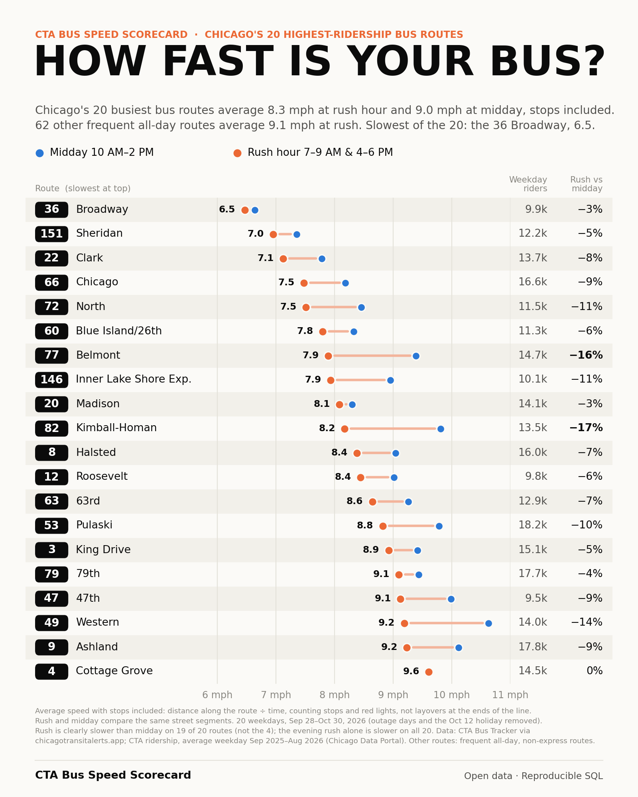

# CTA Bus Speed Scorecard

Explore how fast Chicago's busiest bus routes run at rush hour and midday, with stops and traffic signals included. A static interactive report, downloadable aggregate data, and a reproducible DuckDB/Python pipeline.



The included snapshot covers **20 weekdays, September 28–October 30, 2026**. It reports 8.3 mph at rush hour across the 20 busiest routes, compared with 9.0 mph at midday. This is independent analysis, not an official CTA product or a live tracker.

## View the report — no dependencies

Requires Python 3.10+ and a modern browser:

```sh
git clone https://github.com/MisterClean/cta-bus-speed-scorecard.git
cd cta-bus-speed-scorecard
python -m http.server 8000 --bind 127.0.0.1
```

Open **http://localhost:8000**. Serve the directory over HTTP; opening `index.html` directly can block the data fetches. No API key, account, npm install, or build step is needed. All page assets are local; no analytics or third-party scripts are loaded. The relative URLs also work under a GitHub Pages project subdirectory.

## Run the analysis

```sh
python -m venv .venv
. .venv/bin/activate
# Windows PowerShell: .venv\Scripts\Activate.ps1
pip install -r requirements.txt
python -m unittest discover -s tests -v
```

The bundled importer downloads public daily archives, verifies their byte size, SHA-256 and row count, and creates the schema expected by the scorecard. Requires `curl` on PATH and network access to the archive and Chicago Data Portal. Allow several GB of disk space and up to 12 GB RAM for the full analysis; downloads are approximately 1.1 GB compressed for this window. The scorecard opens the archive database read-only.

```sh
python scripts/transit_archive.py ingest \
  --db local/transit.duckdb --raw-dir local/raw --kinds bus \
  --days 33 --end 2026-10-30 --as-of 2026-10-31
python scripts/bus-speed-scorecard/build.py \
  --db local/transit.duckdb --ridership local/cta-bus-daily.csv \
  --fetch-ridership --out data/bus-speed-scorecard
```

The importer is restartable. Retain `local/raw/index.pinned.json` for provenance; pass it with `--index` to reuse that manifest. Changed source checksums cause a failure rather than silently replacing an ingested day. If the upstream archive returns 403 or is unavailable, the included report and tests still work offline; use a previously downloaded, verified cache and pinned index to rebuild.

**This is a dated study.** Ridership queries are fixed to September 2025–August 2026. Day exclusions, holiday and outage sensitivity runs, narrative dates, and some geographic callouts are specific to fall 2026. For a new period, audit feed coverage first and update those choices in `build.py` and the report text. Changing only the download dates is insufficient. `--no-sensitivity` skips extra sensitivity runs while developing.

To render graphics from the included aggregate data:

```sh
python scripts/bus-speed-scorecard/render_social.py --variant dumbbell \
  --data data/bus-speed-scorecard/scorecard.json --out images/cta-bus-speed-scorecard.png
python scripts/bus-speed-scorecard/render_map.py \
  --cells data/bus-speed-scorecard/corridor_cells.csv \
  --data data/bus-speed-scorecard/scorecard.json \
  --wards data/chicago-wards.geojson --out images/cta-bus-speed-map.png
python scripts/bus-speed-scorecard/render_card.py \
  --data data/bus-speed-scorecard/scorecard.json --out images/cta-bus-speed-scorecard-card.png
```

Renderers use available system fonts; pass `--headline-font path/to/font.ttf` to choose a licensed font. A portable HTML with embedded charts and data can be created with `python scripts/bus-speed-scorecard/bundle_artifact.py --out dist/scorecard.html`. Downloads within that file remain external; use `--link-base https://your-host.example/project/` to point them at your hosted copy.

## Understand and reuse the data

- [Methodology, thresholds, findings and limitations](docs/bus-speed-scorecard.md)
- [Input schema and source rights](docs/DATA.md)
- [Pipeline file guide](scripts/bus-speed-scorecard/README.md)
- [Source archive checksums](data/bus-speed-scorecard/source_manifest.csv)
- [Contributing](CONTRIBUTING.md) · [Security](SECURITY.md) · [MIT license](LICENSE)

`scorecard.json` supplies the report's metrics and embedded SQL. CSVs provide route/hour/day totals, spatial cells, pattern decisions and the QA funnel. Speeds use identical spatial cells and distance weights across periods; they are **not arithmetic means of GPS speeds**. Confidence intervals resample service days. Hourly charts use all service in each hour, unlike the fixed-segment headline comparisons. Route-hour totals alone cannot reproduce the fixed-segment results or confidence intervals.

The snapshot is fall weekdays only, bus-weighted rather than rider-weighted, and pools directions on maps. It measures in-service travel, not a passenger's complete trip or on-time performance. See the methods before comparing it with other speed estimates.
